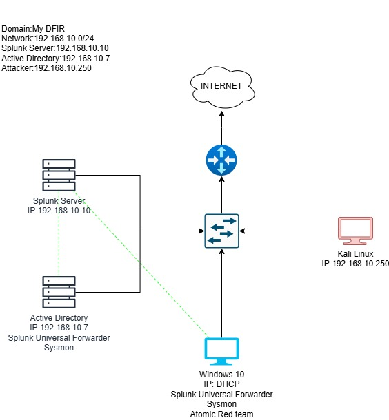
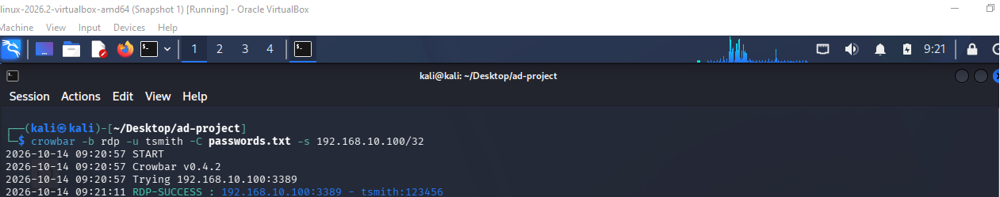

# Enterprise Active Directory & Splunk SOC Lab (`MyDFIR`)

## 🎥 Project Walkthrough & Links
* **Video Walkthrough:** [[Watch 2-min Video Demonstration here](https://www.loom.com/share/339afa172a0140c5b97075efa592907e)]
* **LinkedIn Post:** [Insert Your LinkedIn Project Post Link Here]

---

## 🚀 Project Overview
This project simulates an on-premise corporate network environment to practice security monitoring, Active Directory administration, adversary emulation, and SIEM log analysis. Built from scratch in VirtualBox, this lab observes real-world attack telemetry and triages alerts using Splunk Enterprise.

---

## 🏗️ Architecture & Topology

| Host / Node | Operating System | IP Address | System Role & Function |
| :--- | :--- | :--- | :--- |
| **Splunk SIEM** | Ubuntu Server 22.04 | `192.168.10.10` | Central SIEM & Log Aggregator (Port 9997) |
| **Domain Controller** | Windows Server 2022 | `192.168.10.7` | AD DC (`MyDFIR.local`), DNS, DHCP |
| **Target Endpoint** | Windows 10 Pro | `192.168.10.100` | Domain workstation with Sysmon & Splunk Forwarder |
| **Attacker Host** | Kali Linux | `192.168.10.250` | Adversary emulation & brute-force testing |



---

## 🛠️ Implementation Steps

1. **Network Configuration:** Configured static IP addressing across all VMs within a dedicated VirtualBox internal network segment (`192.168.10.0/24`).
2. **Active Directory Deployment:** Promoted Windows Server 2022 to Active Directory Domain Controller (`MyDFIR.local`), structured Organizational Units (OUs), created domain accounts, and joined the Windows 10 target machine to the domain.
3. **Telemetry & Forwarding:** Installed **Splunk Universal Forwarders** and **Sysmon** (utilizing Olaf Hartong's configuration) on Windows endpoints. Configured custom `inputs.conf` files to ingest Application, Security, System, and Sysmon event logs directly into a custom `endpoint` index.
4. **Service Hardening:** Modified the SplunkForwarder service execution account from `NT SERVICE\SplunkForwarder` to **Local System Account** to resolve permission constraints on elevated Windows security event channels.

---

## 🔴 Attack Simulation & Telemetry Analysis

### 1. Brute-Force Authentication Test (`Crowbar`)
* **Execution:** Used Kali Linux (`192.168.10.250`) to launch a targeted credential brute-force attack against the Windows 10 target (`192.168.10.100`) via RDP (`port 3389`) using `crowbar`.
* **Telemetry Captured:** Generated high-volume Windows Security Event Logs (`EventCode=4625` for failed logins and `EventCode=4624` for successful authentications).



* **Splunk Query & Triage:**
```spl
index=endpoint (EventCode=4625 OR EventCode=4624)
| table _time, host, TargetUserName, Source_Network_Address, EventCode
| sort - _time
Telemetry Findings: Splunk successfully surfaced repeated failed logon attempts originating from the attacker IP (192.168.10.250), detailing exact timestamps, hostnames, and target usernames.

2. TTP Simulation via Atomic Red Team

    Simulation: Executed specific adversary emulation procedures (focusing on account discovery and credential access techniques) using Atomic Red Team on the Windows 10 endpoint.

    Splunk Detection: Sysmon logs captured suspicious process creation events (EventCode=1) and command-line parent-child execution trees, allowing for rapid threat hunting.

💡 Analyst Remediation Note

    Incident ID: INC-2026-0428

    Target Account: MyDFIR\TargetUser

    Source IP: 192.168.10.250 (External Attacker Segment)

    Finding: Anomaly detection flagged multiple failed authentication attempts (EventCode=4625) within a short timeframe against domain user accounts originating from source IP 192.168.10.250, immediately followed by successful logon establishment (EventCode=4624).

    Action Taken & Remediation:

        Endpoint Containment: Isolated the affected endpoint (192.168.10.100) via hypervisor/network controls.

        Account Revocation: Disabled compromised domain account MyDFIR\TargetUser pending verification and revoked active RDP sessions.

        Credential Reset: Enforced immediate password reset upon account re-enablement.

        Escalation: Documented indicators of compromise (IOCs) and escalated event to Tier-2 Incident Response.
